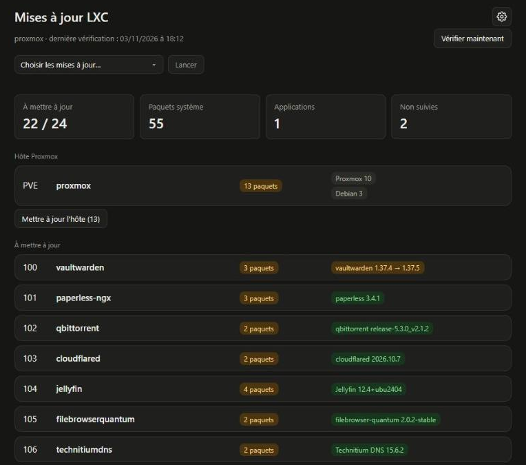

# lxc-update-watch

A small web page that shows which of your Proxmox LXC containers have **system updates** (apt / apk), **application
updates** (community-scripts helper scripts, add-ons, GitHub releases, apt packages) and **Docker image updates**,
and can apply them from the page, with a live console and an optional backup first.



- Detects updates for containers created by the [community-scripts](https://github.com/community-scripts/ProxmoxVE)
  helper scripts with **no configuration**: it reads the scripts themselves and applies the same rule they do.
- Docker images (Docker Hub, ghcr.io, quay.io, private registries) are compared with the registry digest.
- Updates: system packages, applications (official *PVE LXC Apps Update* script) and Docker Compose stacks, one or
  several in one go (optional `vzdump` backup first).
- Proxmox host: the packages `apt-get dist-upgrade` would install on the node itself (the *Updates* panel of the
  Proxmox web interface), by origin (Proxmox, Debian), and an *Upgrade the host* button, which is refused when a
  new kernel is included (that one is for the Proxmox interface, where you can watch the reboot).
- Bilingual interface (English / French), chosen with the EN / FR switch or the browser language.
- Live check: **Check now** animates each container row while its system packages, application version and Docker
  images are being checked, with a progress bar.
- Pull-based design: the Proxmox host never accepts incoming connections.

## How it works

```
 Proxmox host                                   LXC "web service"
 ┌──────────────────────────┐   report (HTTP)   ┌──────────────────────────┐
 │ collector (Python, root) │ ────────────────► │ Flask page + job queue   │
 │  - pct exec in each CT   │ ◄──────────────── │  - shows the report      │
 │  - systemd timers        │  polls every min  │  - stores action requests│
 └──────────────────────────┘                   └──────────────────────────┘
```

- `collector/lxc_collect.py` runs **on the Proxmox host** (it needs `pct exec`), once a day and whenever the page asks
  for a check or an action. Standard library only.
- `server/` is a Flask service running in **its own LXC**. It never talks to the host: the collector polls it every
  minute for requests, runs them and streams the output back.
- `deploy.ps1` installs and updates both from a Windows machine (see below).

## Requirements

- Proxmox VE 9 or any host with **Python 3.13 or newer** (Proxmox VE 9 is based on Debian 13, which ships 3.13).
  The collector uses the standard library only.
- An LXC with Python 3.13 or newer for the web service (a Debian 13 container works out of the box; Flask and
  gunicorn are installed in a virtual environment).
- Python 3.13 is the only version the automated tests run against.

## Install

### With `deploy.ps1` (Windows, recommended)

Requires the OpenSSH client (`ssh`, `scp`) and PowerShell 5.1+. Create an empty Debian/Ubuntu LXC for the web
service, then:

```powershell
.\deploy.ps1                      # interactive menu
.\deploy.ps1 -Action full         # guided installation, step by step
.\deploy.ps1 -Action update       # redeploy only what differs from your local copy
.\deploy.ps1 -Action dry-run      # collect without sending anything, readable summary
.\deploy.ps1 -Action status       # services, timers, page, versions, deployed files
```

If PowerShell refuses to run the script: `powershell -ExecutionPolicy Bypass -File .\deploy.ps1`.

- The Proxmox password is asked **once** per run, kept in memory only and handed to `ssh`/`scp` through `SSH_ASKPASS`.
  Nothing is written to disk or installed on Proxmox (a permanent SSH key is possible but optional: `-Action ssh-key`).
- On the first run the script asks for the Proxmox host (IP or name) and the CTID of the web service's LXC, then
  remembers them in `deploy.settings.json` (no secret in it, git-ignored). They can also be given with
  `-ProxmoxHost`, `-User` (default `root`) and `-ServiceCtid`, which override the saved values.
- Replaced files are backed up on Proxmox (`.bak-YYYYMMDDHHMMSS`, three kept). Your
  `/etc/lxc-update-watch.json` is never overwritten: only the token (aligned with the service's) and missing keys
  are added, with a backup.
- Other actions: `collector`, `service`, `config`, `run-now`, `logs`.

### By hand

Web service, inside the LXC:

```bash
apt install -y python3-venv openssl
mkdir -p /opt/lxc-update-watch && cd /opt/lxc-update-watch
# copy VERSION, server/ and deploy/ here
python3 -m venv venv && venv/bin/pip install -r server/requirements.txt
echo "LXC_WATCH_TOKEN=$(openssl rand -hex 24)" > /etc/lxc-update-watch.env
cp deploy/lxc-update-watch.service /etc/systemd/system/
systemctl enable --now lxc-update-watch          # page on http://<lxc-ip>:8080
```

Collector, on the Proxmox host:

```bash
mkdir -p /opt/lxc-update-watch/collector
# copy VERSION to /opt/lxc-update-watch/ and lxc_collect.py to the collector/ folder
cp collector/config.example.json /etc/lxc-update-watch.json   # then edit it (server_url, token)
cp deploy/lxc-collect.service deploy/lxc-collect.timer deploy/lxc-collect-poll.service deploy/lxc-collect-poll.timer /etc/systemd/system/
systemctl daemon-reload && systemctl enable --now lxc-collect.timer lxc-collect-poll.timer
python3 /opt/lxc-update-watch/collector/lxc_collect.py --dry-run     # test without sending
```

## Configuration

The collector reads `/etc/lxc-update-watch.json` (override with `LXC_WATCH_CONFIG`).

| Key | Meaning |
| --- | --- |
| `server_url`, `token` | Address of the web service and its `LXC_WATCH_TOKEN` (required). |
| `github_token` | Optional. Raises the GitHub API rate limit (60 requests/hour without it). |
| `auto_apps` | `true` by default. `false` disables the automatic helper-script detection. |
| `apps` | Manual entries, keyed by CTID. They take precedence over the automatic detection (see below). |
| `backup_storage` | Proxmox storage for the *Back up before ...* options (`pvesm status --content backup` lists them). Without it the option is unavailable. |
| `upgrade_workers` | Containers upgraded in parallel by the system update button (default 4). |
| `app_update_workers` | Containers updated in parallel by the application update button (default 2). |
| `docker_update_workers` | Containers whose Docker stacks are updated in parallel by the Docker update button (default 2). |
| `allow_host_upgrade` | `true` by default; set it to `false` to remove the *Upgrade the host* button (the host's updates are still listed). |
| `registry_auth` | Credentials for private registries: `{"ghcr.io": {"username": "...", "token": "..."}}`. |

Environment of the web service (`/etc/lxc-update-watch.env`):

| Variable | Meaning |
| --- | --- |
| `LXC_WATCH_TOKEN` | Shared secret used by the collector (required). |
| `LXC_WATCH_DATA` | State directory (`/var/lib/lxc-update-watch` with the provided unit). |

### Automatic detection of applications

For every running container the collector:

1. finds the helper script from the container's host name (`filebrowserquantum` matches `filebrowser-quantum`),
   among `ct/` scripts and `tools/addon/` add-ons;
2. reads its `check_for_gh_release` calls: tracked component, GitHub repository, pinned version, tag prefix;
3. checks that the version file `/root/.<component>` exists in the container (otherwise the container is ignored);
4. applies the script's own rule: an update exists when the installed version differs from the pinned version or,
   if nothing is pinned, from the latest stable release.

So the page shows what the script itself would offer, and follows changes (a newly pinned version, a new component).
Scripts and the index are cached for 24 hours in `/var/cache/lxc-update-watch`.

### Manual entries (`apps`)

Only needed for what the automatic detection does not cover.

```json
"apps": {
  "103": {"name": "cloudflared", "apt_package": "cloudflared"},
  "106": {"name": "Technitium DNS", "repo": "TechnitiumSoftware/DnsServer",
          "version_file": "/root/.technitium", "update_cmd": "update"}
}
```

| Key | Meaning |
| --- | --- |
| `name` | Displayed name. |
| `apt_package` | Application installed with apt: an update exists when this package is in the pending upgrades. |
| `repo` | GitHub repository whose latest release is compared. |
| `version_file` or `version_cmd` | File, or command run inside the container, giving the installed version. |
| `version_regex` | Optional; group 1 is the version when the format is unusual. |
| `version_prefix` | Optional; only compare with releases whose version starts with this prefix (`"1."` stays on the 1.x branch). |
| `pve_script` / `pve_repo` | Optional; read the version a helper script pins instead of using the latest release. |
| `update_cmd` | Optional; command shown on the page to update the application. |

## Updates

The *Choose updates* menu (top left of the page) lists the three updates below with the number of containers
concerned; tick one or several, then press *Run*. A click records a request on the service; the host's timer picks it up within a minute, runs it and streams the
output to the page's console, with one tab per container (waiting, running, ok or failed) and a color per
container in the *All* view. There is no password: anyone who can open the page can start them (see the security
notes below).

- **Update system** runs `apt-get upgrade` (never `dist-upgrade`) or `apk upgrade` in containers with pending
  packages, in parallel. Services may restart, Docker included.
- **Update applications** runs the official `tools/pve/update-apps.sh` unattended, one instance per container, for
  containers created by a helper script whose application has an update. With `backup_storage` set, the
  *Back up before updating applications and Docker stacks* option of the Options menu (gear icon, on by default,
  remembered by the browser) runs a `vzdump` before each update. The *Back up before upgrading system packages*
  option next to it is off by default: tick it to back up before system updates too. Containers that need a reboot are listed in the console.
  Add-ons have no `update` command: the page shows the command to run inside the container.
- **Update Docker stacks** is for the containers that have a Docker image with a newer version. Inside each container
  it finds the Docker Compose stacks of the running containers (Compose records the project directory and files in
  labels on every container it creates), then runs `docker compose pull` and `docker compose up -d` for each one: only
  the services whose image changed are recreated, and volumes are never touched. Containers started another way
  (`docker run`) cannot be recreated safely and are listed as "to update by hand". If a stack fails, nothing is
  removed. With *Remove old Docker images after updating Docker stacks* (Options menu, on by default) the collector
  then runs `docker image prune -f` once every stack succeeded, which only removes images that no longer have a name
  and are used by no container (never `-a`, never volumes). *Back up before updating applications and Docker stacks*
  applies here too. Beware of mobile tags such as `latest` on databases: a new major version can need a migration.
- **Upgrade the host** (button of the *Proxmox host* section) runs `apt-get dist-upgrade` on the node, non-interactive
  and keeping your configuration files (`--force-confold`), with the output in the console. It is refused when the
  list contains a Proxmox or PVE kernel, because the node must then be rebooted and that is better watched from the
  Proxmox interface. Running guests are not stopped, but the Proxmox services (the web interface included) can restart
  during the upgrade, so the page of Proxmox may blink. The package lists are the ones Proxmox refreshes itself every
  day; this project never runs `apt-get update`. Set `allow_host_upgrade` to `false` in the collector config to remove
  the button. Once it is done, only the host's list is read again (the containers are not checked again).
- **Last job card.** The results of the last job stay on the page, with its console. *Clear* (once the job is over)
  removes them; more than three successes are folded into one line, failures always stay visible.
- **Several at once.** The ticked updates form one job. The containers run in parallel (as many as the smallest of
  the workers settings of the ticked updates), but each container goes through the steps one after the other, always
  in this order: system, applications, Docker stacks. A container is backed up once, right before its first step
  that has its backup option ticked (so the system step can run without a backup, then the applications are backed up). A container stops at its first failed step (the rest is shown as not run in its console tab); the other
  containers carry on.
Security notes: **by default the page has no login**. Anyone who can open it can read the state and the console
output, and can start the update buttons, which run `apt-get upgrade` and the community update scripts as root on the
host through the collector. Only the fixed actions of the page can be started, never an arbitrary command, and
requests must be JSON so a cross-site form cannot trigger one. Either keep the page on your local network, turn on
the optional OpenID Connect login below, or put an authenticating reverse proxy in front of it.

### Optional login with OpenID Connect

Set `OIDC_ISSUER` in `/etc/lxc-update-watch.env` to require a sign-in with any OpenID Connect provider (Authelia,
Keycloak, Authentik...). Without it nothing changes. Once enabled, every page and API used by a browser needs a
signed-in user; the collector keeps using its `LXC_WATCH_TOKEN`, and `/healthz` stays open.

| Variable | Meaning |
| --- | --- |
| `OIDC_ISSUER` | Issuer URL of the provider, for example `https://auth.example.com`. Setting it turns the login on. |
| `OIDC_CLIENT_ID`, `OIDC_CLIENT_SECRET` | Client registered at the provider (required). |
| `OIDC_REDIRECT_URI` | Public address of the callback, `https://lxc.example.com/auth/callback` (required; it must match the provider's configuration exactly). |
| `OIDC_ALLOWED_GROUPS`, `OIDC_ALLOWED_USERS` | Optional, comma separated. When either is set, only these groups or users (user name or e-mail) get in. When both are empty, every user the provider authenticates is accepted. |
| `OIDC_SCOPES` | Default `openid profile email groups`. |
| `OIDC_TOKEN_AUTH_METHOD` | Default `client_secret_basic`; use `client_secret_post` if the provider's client is set up that way. |
| `LXC_WATCH_SECRET_KEY` | Optional key signing the session cookie; derived from `LXC_WATCH_TOKEN` when unset. |

Example with Authelia. In Authelia's `configuration.yml` (the secret is stored hashed, e.g. with
`authelia crypto hash generate pbkdf2 --variant sha512`):

```yaml
identity_providers:
  oidc:
    clients:
      - client_id: lxc-update-watch
        client_name: LXC update watch
        client_secret: '$pbkdf2-sha512$...'
        public: false
        authorization_policy: one_factor
        redirect_uris:
          - https://lxc.example.com/auth/callback
        scopes: [openid, profile, email, groups]
        token_endpoint_auth_method: client_secret_basic
```

then in `/etc/lxc-update-watch.env` of the web service (the plain secret), followed by
`systemctl restart lxc-update-watch`:

```
OIDC_ISSUER=https://auth.example.com
OIDC_CLIENT_ID=lxc-update-watch
OIDC_CLIENT_SECRET=the-plain-secret
OIDC_REDIRECT_URI=https://lxc.example.com/auth/callback
OIDC_ALLOWED_GROUPS=admins
```

Notes: the web service must reach the provider (it fetches `/.well-known/openid-configuration` at the first login)
and the provider must be served over HTTPS in practice; the page itself should be reached through the HTTPS address
of `OIDC_REDIRECT_URI` (reverse proxy), which also makes the session cookie `Secure`. The session lasts 12 hours.
*Sign out* in the Options menu ends the page's session only, not the one at the provider: a page confirms it, and
*Sign in again* signs you straight back in while the provider's session is open (sign out of Authelia too to change user). If the provider is
down nobody can sign in to the page, but the collector keeps reporting.

## Languages

The interface is available in English and French. The language is taken from the `lang` cookie (set by the language
selector of the Options menu, the gear icon at the top right of the page), then from the browser's `Accept-Language`, then defaults to English.
Translations live in `server/i18n.py`; adding a language means adding one dictionary to `STRINGS`, its code to
`SUPPORTED` and its name to `LANGUAGE_NAMES` (a test checks that every key exists in all languages). Technical
output (console, job results, collector messages) is always in English.

## Versioning

The project follows [Semantic Versioning](https://semver.org). The single source of truth is the `VERSION` file;
the collector and the web service both read it, report their version (page footer, `--version`, `/api/status`) and
the page warns when the collector and the service run different versions. `deploy.ps1 -Action status` compares the
deployed files with your local copy.

Release process:

1. Move the notes of `## [Unreleased]` in `CHANGELOG.md` under a new `## [X.Y.Z] - date` heading, and update `VERSION`.
2. Commit (`Release X.Y.Z`), then tag and push: `git tag vX.Y.Z && git push origin main vX.Y.Z`.
3. The `release` workflow checks that the tag matches `VERSION` and publishes a GitHub release with the changelog notes.

## Development

```bash
pip install -r requirements-dev.txt
python -m pytest
```

The tests need no network and no Proxmox: the collector's `pct` calls and the GitHub requests are replaced by fakes.
